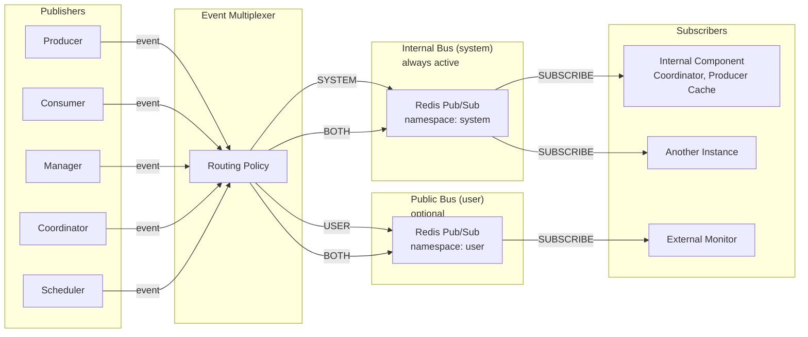

# Event Bus

RedisSMQ uses Redis Pub/Sub to deliver real‑time notifications about system activity. There are **two independent event buses**:

- **Internal Event Bus (system)** — always active, used for cross‑instance synchronisation and internal component communication.
- **Public Event Bus (user)** — optional, intended for external monitoring and integration.

An **event multiplexer** routes each event to one or both buses based on a static routing policy.

## How It Works

Each bus uses a separate Redis Pub/Sub namespace:

```
redis-smq:events:system:*   → Internal bus
redis-smq:events:user:*     → Public bus
```

The channel name is derived from the event name and the bus namespace. For example:

- Internal: `redis-smq:events:system:queue.stateChanged`
- Public: `redis-smq:events:user:queue.queueCreated`



The multiplexer ensures internal events never reach external subscribers unless explicitly routed to the public bus, and public events can be disabled without affecting system synchronisation.

## Characteristics

| Property              | Internal Bus (system)                                      | Public Bus (user)                           |
|-----------------------|------------------------------------------------------------|---------------------------------------------|
| **Purpose**           | Cross‑instance synchronisation, internal component updates | External monitoring and integration         |
| **Activation**        | Always active (required for correct operation)             | Optional — started on demand                |
| **Persistence**       | None — events are not stored                               | None                                        |
| **Delivery**          | Fire‑and‑forget, no acknowledgment                         | Fire‑and‑forget                             |
| **History / Replay**  | No                                                         | No                                          |
| **Channel prefix**    | `redis-smq:events:system:`                                 | `redis-smq:events:user:`                    |
| **Wire format**       | JSON array of positional arguments                         | JSON array of positional arguments          |
| **Event routing**     | Depends on routing policy                                  | Depends on routing policy                   |

## Event Routing Policy

The routing policy defines where each event is published. The default targets are:

| Event                         | Target   | Notes                                                       |
|-------------------------------|----------|-------------------------------------------------------------|
| `queue.queueCreated`          | `BOTH`   | Coordinator discovers new queue + public notification       |
| `queue.queueDeleted`          | `BOTH`   | Internal cache update + public notification                 |
| `queue.consumerGroupCreated`  | `BOTH`   | Internal cache update + public notification                 |
| `queue.consumerGroupDeleted`  | `BOTH`   | Internal cache update + public notification                 |
| `queue.stateChanged`          | `BOTH`   | Internal consumer reaction + public monitoring              |
| `configuration.updated`       | `SYSTEM` | Only internal — not exposed publicly                        |
| All producer events           | `USER`   | Public only — for external monitoring                       |
| All scheduler events          | `USER`   | Public only — for external monitoring                       |
| All consumer events           | `USER`   | Public only — for external monitoring                       |

> ⚠️ Producer, scheduler, and consumer events are **not** used for internal synchronisation. They are purely informational and intended for observability.

## Event Taxonomy

Messages reach the system through two flows, and the public event taxonomy reflects that split:

| Flow      | Produce-time event          | Fire-time event(s)                                                          |
|-----------|-----------------------------|-----------------------------------------------------------------------------|
| Immediate | `producer.messagePublished` | *(none — the message is pending as soon as it is produced)*                 |
| Scheduled | `producer.messageScheduled` | `scheduler.messagePublished` **or** `scheduler.messageDeadLettered`         |

- **Producer events** fire when `produce` succeeds. One event per destination queue, multiplied by the number of consumer groups for Pub/Sub destinations — matching the number of IDs the produce call returns.
- **Scheduler events** fire later, whenever the scheduled message becomes due. That may be milliseconds after produce, hours later, or never (if the message is cancelled, deleted, or the queue is dropped before its due time).

> ⚠️ **Breaking change.** `producer.messagePublished` no longer fires for scheduled messages becoming pending. Subscribers that relied on that signal (the pre-change scheduled publisher emitted `producer.messagePublished` with an empty `producerId`) should migrate to `scheduler.messagePublished`. No other event's semantics changed.

### Full lifecycle of a scheduled message

For a repeating scheduled message with `repeat = 2`, the event sequence
depends on whether a delay is set.

**With a delay** (e.g. `SetScheduledDelay(10 * time.Second)`):

```
producer.messageScheduled         ← produce returns
scheduler.messagePublished        ← clone 1 (at produce+10s)
scheduler.messagePublished        ← clone 2 (10s + repeat period)
scheduler.messagePublished        ← parent moved to pending
3 events total.
```

**Without a delay**:

```
producer.messageScheduled         ← produce returns
scheduler.messagePublished        ← clone 1 (immediate)
scheduler.messagePublished        ← parent moved to pending
2 events total.
```

Note the one-event difference: without a delay, the initial scheduled
entry is counted as the first repeat, so `repeat = N` yields N total
events. With a delay, the delay itself is not counted as a repeat, so
`repeat = N` yields N + 1 total events.

## Event Payload Format

Events are serialised as a JSON array. Each event has a fixed number of positional arguments whose order and types are documented below.

## Event Reference

### Configuration Events

#### `configuration.updated` — Internal only

Fires when system configuration is saved or updated.

**Hybrid wire format.** The subscriber must accept two argument counts:

| Argument | Type   | When present | Description                                                 |
|----------|--------|--------------|-------------------------------------------------------------|
| `config` | object | always       | Full configuration object                                   |
| `version`| number | always       | Configuration version                                       |
| `epoch`  | string | Go publishes | Generation identifier for the config record. **Absent** from TypeScript-originated events. |

- **Go publishers** emit 3 args `(config, version, epoch)`.
- **TypeScript publishers** emit 2 args `(config, version)` — TS has no epoch concept.
- **JS handler dispatch** ignores extra args on the receiving side, so a TS subscriber sees a well-formed 2-arg call even when a Go publisher emitted 3.
- **Subscribers must dispatch on epoch presence**: an empty epoch means "no epoch to compare — fall back to version-only staleness detection" (i.e., reload from Redis when the version differs).

### Queue Events (routed to BOTH)

#### `queue.queueCreated`

| Argument      | Type   | Description                                                    |
|---------------|--------|----------------------------------------------------------------|
| `queue`       | object | `{ ns: string, name: string }`                                |
| `properties`  | object | Queue properties (type, delivery model, message counts, etc.) |

#### `queue.queueDeleted`

| Argument | Type   | Description                     |
|----------|--------|---------------------------------|
| `queue`   | object | `{ ns: string, name: string }` |

#### `queue.stateChanged`

| Argument      | Type   | Description                                                                                         |
|---------------|--------|-----------------------------------------------------------------------------------------------------|
| `queue`       | object | `{ ns: string, name: string }`                                                                     |
| `transition`  | object | State transition object (`from`, `to`, `reason`, `timestamp`, optional `description`/`lockId`/`lockOwner`/`metadata`) |

#### `queue.consumerGroupCreated`

| Argument     | Type   | Description                     |
|--------------|--------|---------------------------------|
| `queue`      | object | `{ ns: string, name: string }` |
| `groupId`    | string | Consumer group identifier       |

#### `queue.consumerGroupDeleted`

| Argument     | Type   | Description                     |
|--------------|--------|---------------------------------|
| `queue`      | object | `{ ns: string, name: string }` |
| `groupId`    | string | Consumer group identifier       |

### Producer Events (USER only)

#### `producer.up`

| Argument      | Type   | Description |
|---------------|--------|-------------|
| `producerId`  | string | Producer ID |

#### `producer.goingUp`

| Argument      | Type   | Description |
|---------------|--------|-------------|
| `producerId`  | string | Producer ID |

#### `producer.down`

| Argument      | Type   | Description |
|---------------|--------|-------------|
| `producerId`  | string | Producer ID |

#### `producer.goingDown`

| Argument      | Type   | Description |
|---------------|--------|-------------|
| `producerId`  | string | Producer ID |

#### `producer.messagePublished`

Fires when an **immediate** (non-scheduled) produce succeeds — one event per destination queue, multiplied by the number of consumer groups for Pub/Sub destinations.

Does **not** fire for scheduled produces; see `producer.messageScheduled` below.

| Argument      | Type   | Description                                                |
|---------------|--------|------------------------------------------------------------|
| `messageId`   | string | Published message ID                                       |
| `queue`       | object | `{ queueParams: { ns, name }, groupId }` (destination)     |
| `producerId`  | string | Producer ID                                                |

#### `producer.messageScheduled`

Fires when a **scheduled** produce succeeds — one event per destination queue, multiplied by the number of consumer groups for Pub/Sub destinations. The message has entered the scheduled set; its due time is set (delay, CRON, repeat) but not yet reached.

Does **not** fire for immediate produces; see `producer.messagePublished` above.

For a repeating message, this fires once — for the parent. Clones created by subsequent repeat ticks each fire `scheduler.messagePublished` (see below), not `producer.messageScheduled`.

| Argument      | Type   | Description                                                |
|---------------|--------|------------------------------------------------------------|
| `messageId`   | string | Message ID                                                 |
| `queue`       | object | `{ queueParams: { ns, name }, groupId }` (destination)     |
| `producerId`  | string | Producer ID                                                |

### Scheduler Events (USER only)

Scheduler events fire when a scheduled message becomes due. They do **not** carry a `producerId` — the scheduler is not a producer, and by the time a message's due time arrives the originating producer may have long since shut down.

#### `scheduler.messagePublished`

Fires when the scheduler moves a due scheduled message into a pending list, ready for consumption. One event per published ID.

- For a **simple** (non-repeating) scheduled message, `messageId` is the message's own ID (as returned by the original produce call).
- For a **repeating** message, `messageId` is the **clone's** ID — the parent stays in the scheduled set for its next tick, so `scheduler.messagePublished` fires once per clone, not for the parent.

| Argument      | Type   | Description                                                              |
|---------------|--------|--------------------------------------------------------------------------|
| `messageId`   | string | Message ID (simple) or clone ID (repeating)                              |
| `queue`       | object | `{ queueParams: { ns, name }, groupId }` (destination)                   |

#### `scheduler.messageDeadLettered`

Fires when a due scheduled message could not be delivered because its target consumer group no longer exists.

On a Pub/Sub queue, a message is bound to a specific consumer group at produce time. If that group is deleted between produce and the message's due time, there is nowhere for the message to go — the scheduler dead‑letters it instead of orphaning it.

- For a **simple** scheduled message, the message itself is dead‑lettered and `messageId` is the message's own ID.
- For a **repeating** scheduled message, the parent is dead‑lettered to terminate its cycle; the would‑be clone for the current firing is discarded. `messageId` is the parent's ID.

| Argument      | Type   | Description                                                              |
|---------------|--------|--------------------------------------------------------------------------|
| `messageId`   | string | Message ID (simple) or parent ID (repeating)                             |
| `queue`       | object | `{ queueParams: { ns, name }, groupId }` — `groupId` is the deleted group |

### Consumer Events (USER only)

#### `consumer.up`

| Argument      | Type   | Description |
|---------------|--------|-------------|
| `consumerId`  | string | Consumer ID |

#### `consumer.goingUp`

| Argument      | Type   | Description |
|---------------|--------|-------------|
| `consumerId`  | string | Consumer ID |

#### `consumer.down`

| Argument      | Type   | Description |
|---------------|--------|-------------|
| `consumerId`  | string | Consumer ID |

#### `consumer.goingDown`

| Argument      | Type   | Description |
|---------------|--------|-------------|
| `consumerId`  | string | Consumer ID |

#### `consumer.messageReceived`

| Argument      | Type   | Description                     |
|---------------|--------|---------------------------------|
| `messageId`   | string | Message ID                      |
| `queue`       | object | `{ queueParams: { ns, name }, groupId }` |
| `consumerId`  | string | Consumer ID                     |

#### `consumer.messageAcknowledged`

| Argument      | Type   | Description                     |
|---------------|--------|---------------------------------|
| `messageId`   | string | Message ID                      |
| `queue`       | object | `{ queueParams: { ns, name }, groupId }` |
| `consumerId`  | string | Consumer ID                     |

#### `consumer.messageUnacknowledged`

| Argument      | Type   | Description                     |
|---------------|--------|---------------------------------|
| `messageId`   | string | Message ID                      |
| `queue`       | object | `{ queueParams: { ns, name }, groupId }` |
| `consumerId`  | string | Consumer ID                     |
| `cause`       | number | Unacknowledgment cause enum     |

#### `consumer.messageDeadLettered`

| Argument      | Type   | Description                     |
|---------------|--------|---------------------------------|
| `messageId`   | string | Message ID                      |
| `queue`       | object | `{ queueParams: { ns, name }, groupId }` |
| `consumerId`  | string | Consumer ID                     |
| `cause`       | number | Dead‑letter cause enum          |

#### `consumer.messageRequeued`

| Argument      | Type   | Description                     |
|---------------|--------|---------------------------------|
| `messageId`   | string | Message ID                      |
| `queue`       | object | `{ queueParams: { ns, name }, groupId }` |
| `consumerId`  | string | Consumer ID                     |

#### `consumer.messageDelayed`

| Argument      | Type   | Description                     |
|---------------|--------|---------------------------------|
| `messageId`   | string | Message ID                      |
| `queue`       | object | `{ queueParams: { ns, name }, groupId }` |
| `consumerId`  | string | Consumer ID                     |

> The `queue` argument on producer, scheduler, and consumer events uses the `QueueParsedParams` shape: a nested `queueParams` object (with `ns` and `name`) and a `groupId` field that is `null`/empty for point-to-point queues.

## Cause Enums

### Unacknowledgment Cause

Used by `consumer.messageUnacknowledged`.

| Value | Name | Description |
|------:|------|-------------|
| 0 | `TIMEOUT` | Message consume timeout exceeded. |
| 1 | `CONSUME_ERROR` | Handler returned an error. |
| 2 | `UNACKNOWLEDGED` | Message explicitly unacknowledged. |
| 3 | `OFFLINE_CONSUMER` | Consumer offline; in‑flight messages recovered. |
| 4 | `SHUTTING_DOWN` | Consumer shut down while processing. |
| 5 | `TTL_EXPIRED` | Message TTL expired. |
| 6 | `QUEUE_STOPPED` | Queue stopped while message in flight. |
| 7 | `QUEUE_INVALID_STATE` | Queue was in invalid state. |
| 8 | `QUEUE_LOCKED` | Queue locked and operation rejected. |
| 9 | `MESSAGE_NOT_FOUND` | Message no longer exists. |
| 10 | `QUEUE_STATE_CHANGED` | Queue state changed during processing. |
| 11 | `QUEUE_NOT_FOUND` | Queue no longer exists. |
| 12 | `UNEXPECTED_ERROR` | Unexpected internal error. |
| 13 | `INVALID_HANDLER_SIGNATURE` | Invalid handler signature. |

### Dead‑Letter Cause

Used by `consumer.messageDeadLettered`.

| Value | Name | Description |
|------:|------|-------------|
| 0 | `TTL_EXPIRED` | Message TTL expired. |
| 1 | `RETRY_THRESHOLD_EXCEEDED` | Message exceeded retry threshold. |
| 2 | `PERIODIC_MESSAGE` | Periodic message (CRON/repeat) was not retried. |

## Subscribing to Events

- Internal components subscribe to the **system bus** (`redis-smq:events:system:*`).
- External monitors and integrations subscribe to the **public user bus** (`redis-smq:events:user:*`).

Language implementations provide typed subscription helpers for the public bus. For example:

```go
// Go example
queueEvents.SubscribeCreated(func(p queueEvents.CreatedPayload) {
    // handle created queue
})
```

```typescript
// TypeScript example
eventBus.on('queue.queueCreated', (queue, properties) => {
    // handle created queue
});
```

The exact API varies by language, but the event names, channel prefixes, and payload formats are identical.

## Best Practices

- Keep event handlers fast; they run synchronously in the subscriber's event loop.
- Do not rely on events for guaranteed data delivery; use message audit for persistent records.
- Unsubscribe when subscriptions are no longer needed.
- Treat the public bus as optional. If you don't need external monitoring, you can avoid starting it entirely.
- Never subscribe to the internal system bus from external code; use the public bus for observability.
- When tracking a scheduled message end-to-end, subscribe to **both** `producer.messageScheduled` (produce-time) and `scheduler.messagePublished` / `scheduler.messageDeadLettered` (fire-time). Neither flow alone gives the full lifecycle.
